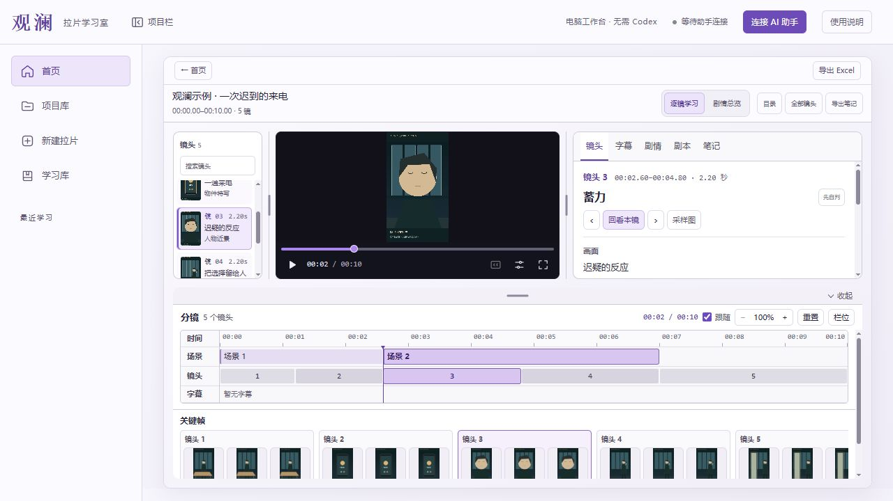

<div align="center">


**给短剧创作者的拉片学习工作台。**

边看原片边拆镜头，复盘开场钩子、情绪推进和剪辑节奏。

[在线使用](https://guanlan-film-study-jz.quirky-wolf-4804.chatgpt.site/) · [下载 Windows 免安装版](https://github.com/XiaoWuheng/guanlan-film-study/releases/download/v0.5.0/Guanlan-Film-Study-0.5.0-Windows-x64.zip) · [v0.5.0 发布页](https://github.com/XiaoWuheng/guanlan-film-study/releases/tag/v0.5.0) · [快速上手](docs/QUICKSTART.md) · [连接 AI](docs/AI-CONNECTION.md)

[更新记录](CHANGELOG.md)
· [MIT 开源许可](LICENSE)
· Web / Windows
[](https://github.com/XiaoWuheng/guanlan-film-study/actions/workflows/ci.yml)

</div>

观澜面向希望学习短剧开场钩子、情绪推进、剪辑节奏与镜头语言的创作者。放入一段片，边播放边定位镜头，记录看见与听见的事实，再分析**为什么此刻这样拍、换一种拍法会怎样、自己的戏可以怎样借用**。

一部剧可以收录多集正片和投流素材。带剧本时可对照文字怎样落到镜头。没有剧本时，可识别画面里的烧录字幕，生成可搜索的原文和中文译文。

## 看一眼


<details>
<summary>查看逐镜学习室</summary>



</details>

*截图使用本项目原创图形示意素材，不包含影视片段、个人项目或密钥。它展示工具操作，不代表真实影片分析效果。*

## 你可以学什么

| 学习内容 | 在观澜里怎样看 |
| --- | --- |
| 镜头时长、景别、运镜与画面 | 原片同步定位，查看起段、中段、末段采样图，逐镜比较 |
| 为什么这样拍 | 将可见证据、拍法解释、替代拍法和适用边界分开阅读 |
| 短剧开场钩子 | 看开场提出了什么问题，观众为何愿意继续看，以及后文怎样回应 |
| 情绪与剪辑节奏 | 将镜头放回段落，观察信息、人物反应、蓄力与释放的接续 |
| 文字怎样成为视听 | 对照独立剧本或字幕原文，关联到具体镜头 |
| 怎样用到自己的戏 | 收藏带来源时间和适用条件的方法；复核后明确选用于某个项目 |

## 开始使用

### Windows 免安装版

1. 下载 [Windows x64 ZIP](https://github.com/XiaoWuheng/guanlan-film-study/releases/download/v0.5.0/Guanlan-Film-Study-0.5.0-Windows-x64.zip) 并解压整个文件夹。
2. 双击 `启动观澜.vbs`，浏览器会打开工作台。
3. 点「看一段示例」试看片和切镜，或点「开始拉片」导入自己的视频。

包内附带运行组件，双击即可使用。AI 分析可连接自己的助手或模型 API。源码压缩包和校验值可在 [v0.5.0 发布页](https://github.com/XiaoWuheng/guanlan-film-study/releases/tag/v0.5.0) 获取。

### 网页版

打开 [观澜网页版 v0.5.0](https://guanlan-film-study-jz.quirky-wolf-4804.chatgpt.site/)，点「看一段示例」即可体验原片与镜头同步。网页项目保存在当前浏览器，模型连接取决于服务商是否允许浏览器请求。也可按[从源码运行](#从源码运行)在本机启动。

| 能力 | 网页版 | Windows 电脑端 |
| --- | --- | --- |
| 本机视频、候选拆镜、同步学习、人工修订 | 支持 | 支持 |
| 自有视觉模型 API | 需服务商允许浏览器连接 | 通过本机转发 |
| AI 助手直接读写项目 | 需电脑端配合 | 支持本机 MCP |
| 公开链接取片 | 交给助手或先取得文件 | 内置直链与部分公开分享页解析 |
| Excel、项目与学习库备份 | 支持 | 支持 |

第一次使用建议从 **1—3 分钟片段**开始。详细步骤见 [快速上手](docs/QUICKSTART.md)。

### 没有影片，也能先试

首页内置原创短片。点镜号可跳回对应画面，进入完整拉片室后从当前位置继续看。想练习人工修订和笔记，可在「备用交接与项目备份」恢复 [原创示例项目](examples/README.md)。

## 一次拉片的流程

```text
放入视频 / 公开链接
       ↓
选择研究范围 → 准备候选镜头 → 回看并局部校正
       ↓
连接自己的助手，或使用自己的视觉模型 API
       ↓
逐镜学习 ↔ 剧本 / 字幕对照 ↔ 人工修订与分项复核
       ↓
导出 Excel / 备份项目 / 收藏导演方法与参考资料
```

**看片与分析同屏。** 镜头目录、双语字幕、连续关键帧与原片同步。场景、镜头、字幕和笔记共用分镜时间线，可缩放时间轴和选择栏位。选择数字换集，收起侧栏后仍能用图标导航。需要校正时，可步进、局部切镜或合并下一镜。

**随看随记。** 字幕逐条修订后，浮层、搜索、时间轴和剧本对照同步更新。片段笔记可截取当前画面并手绘标注。可修订景别、运镜、表演和拍法，保留 AI 原稿供核对。

**按剧学习。** 在整剧资料中记录跨集故事单元、付费卡点和正剧与素材的对应时间，点击即可回看。项目列表支持标题检索、标签、浏览记录和收藏。学习库可按片型和主题整理导演意图、构图、机位、运镜、色彩光影、剪辑和制作方法，保存来源镜号与适用条件，支持自定义分类和导出方法论 Excel。

## AI 怎么接

- **已有 AI 助手**：Windows 工作台提供本机 MCP。连接后，助手可读取项目和当前选段并将分析写回报告。
- **自己配置 API**：填写兼容 Chat Completions、支持图片输入的模型地址、模型名与 API Key。
- **暂不连接 AI**：仍可回看片段、校正镜头、写人工观察、整理参考和导出已有内容。

助手订阅不会自动变成 API Key，工具也不会自动借用平台登录凭证。调用可能产生费用，开始前会显示预计请求和图片数量。配置示例与兼容范围见 [AI 连接说明](docs/AI-CONNECTION.md)。

## 导出的是什么

可导出当前集、指定集数或整剧 **`.xlsx`**。多集工作簿有剧集目录和整剧结构，可从目录直达各集逐镜表。截图随表保存，支持筛选和冻结表头。

| 工作表 | 内容 |
| --- | --- |
| 逐镜表 | 镜号、时间、镜长、采样图、景别、运镜、画面、节奏、拍法与笔记 |
| 拍法详解 | 表演、机位、光影、声音记录、替代方案及核验状态 |
| 全片分析 | 开场钩子、镜头组合、剪辑方法、借用与练习 |
| 情绪节拍 | 段落时间、信息变化、推测观看效果与关联镜号 |
| 剧本对照 / 剧本原文 | 文字定位、原文、视听实现及对应说明 |
| 使用与范围 | 来源、研究范围、时间约定与核验边界 |
| 人工与 AI 对照 | 保留既有分析与人工修订，方便回查 |
| 人物与场景 / 画面笔记 | 项目有对应记录时，附逐人证据与标注截图 |

需要在另一台电脑继续学习时，使用项目备份和原片恢复。学习库单独备份。Excel 适合阅读与分享，工作台提供原片播放和同步高亮。

## 现在的能力范围

- **候选拆镜**：每 0.25 秒采样并寻找画面变化峰值；不是逐帧准确检测，快切、叠化、相似构图和运动仍可能误判。
- **视觉分析**：每镜使用稀疏采样图，不能覆盖完整动作、表演或运镜；“为什么这样拍”是有依据的解释，不是已证实的导演意图。
- **声音**：默认流程未给 AI 提供音轨。字幕可以作为文字证据，不能证明已听过对白、语气、音乐和音效。
- **字幕**：默认取样画面下部；其他位置、极短或模糊字幕可能漏识别。保留原文语言，时间为近似值。
- **片源**：电脑端支持公开 HTTPS 直链与解析组件可取得的单文件视频，最多 512MB；不读取浏览器登录状态，不承诺通用解析网盘、付费或受保护内容。
- **规模**：当前每项目最多 10 分钟、500 镜；学习库单附件最多 4MB，整体约 28MB。
- **验证**：已检查本机核心逻辑、人工记录、切镜与撤销、Excel 导出、公开样片导入及模拟模型流程；尚未完成跨服务商付费模型和大量真实片源的系统测试。

## 数据与隐私

项目默认保存在当前设备。网页版使用浏览器存储；电脑端同时保存在本机 `data/`。电脑端只监听 `127.0.0.1`。

使用 API 时，采样图、字幕、剧本、学习要求及主动选用的方法会发送到你配置的服务商。Key 只在本次页面和请求中使用，不写入项目、学习库、导出报告或源码。参考附件不会自动发给模型。

公开源码和发布包不包含个人影片、项目、笔记、模型凭据或个人历史。更多说明见 [数据与能力说明](docs/DATA-AND-LIMITS.md)。

## 从源码运行

需要 **Node.js 24 或更新版本**。应用无 npm 运行依赖，无需先安装依赖包。

```bash
git clone https://github.com/XiaoWuheng/guanlan-film-study.git
cd guanlan-film-study
npm start
```

在浏览器打开终端显示的本机地址，默认是 `http://127.0.0.1:8780`。源码启动不会自动打开浏览器。Windows 便携包已验证；其他系统可运行基础本机服务，但链接解析组件和桌面启动方式尚未完成适配与实测。

```bash
npm test                 # 核心逻辑测试
npm run check            # 语法、公开文件与文档链接检查
npm run runtime:fetch    # Windows 打包前：下载并校验官方运行组件
npm run build:windows    # Windows 下生成免安装 ZIP 和 SHA256
```

模块与打包说明见 [开发说明](docs/DEVELOPMENT.md)。

## 参与改进

欢迎在 [Issues](https://github.com/XiaoWuheng/guanlan-film-study/issues) 报告问题或提出学习场景，也欢迎提交 PR。复现问题时请使用原创、公开许可或脱敏片段，提供版本、操作步骤、预期与实际结果。

优先改进方向：切点校正体验、音轨与完整动态证据、模型兼容性、字幕校对和跨项目方法检索。路线见 [ROADMAP](ROADMAP.md)，贡献步骤见 [CONTRIBUTING](CONTRIBUTING.md)。

## 相关项目与致谢

- [观澜 AI 导演工作台](https://github.com/XiaoWuheng/guanlan-ai-director)：同作者的分镜与制作工具；本项目专注拉片学习，保持独立使用。
- [yt-dlp](https://github.com/yt-dlp/yt-dlp)：Windows 公开链接解析组件。
- [Node.js](https://nodejs.org/)：电脑端运行时。
- [LosslessCut](https://github.com/mifi/lossless-cut)、[PySceneDetect](https://github.com/Breakthrough/PySceneDetect)：相关视频工具；仓库首页借鉴其清晰的下载入口、上手示例和能力范围组织方式。本项目未接入它们的剪辑或检测引擎。

## 许可

观澜自有代码及原创演示素材采用 [MIT License](LICENSE)。Node.js、yt-dlp 和标题所用志莽行书分别保留原许可证，详见 [THIRD_PARTY_NOTICES](THIRD_PARTY_NOTICES.md)。用户导入的影片、剧本、参考资料及模型服务不属于本项目的 MIT 授权范围。

---

**Guanlan Film Study** is a local-first shot-by-shot learning workspace with synchronized playback, script/subtitle references, human review, reusable directing methods and Excel export. Bring your own AI assistant or vision-model API.
