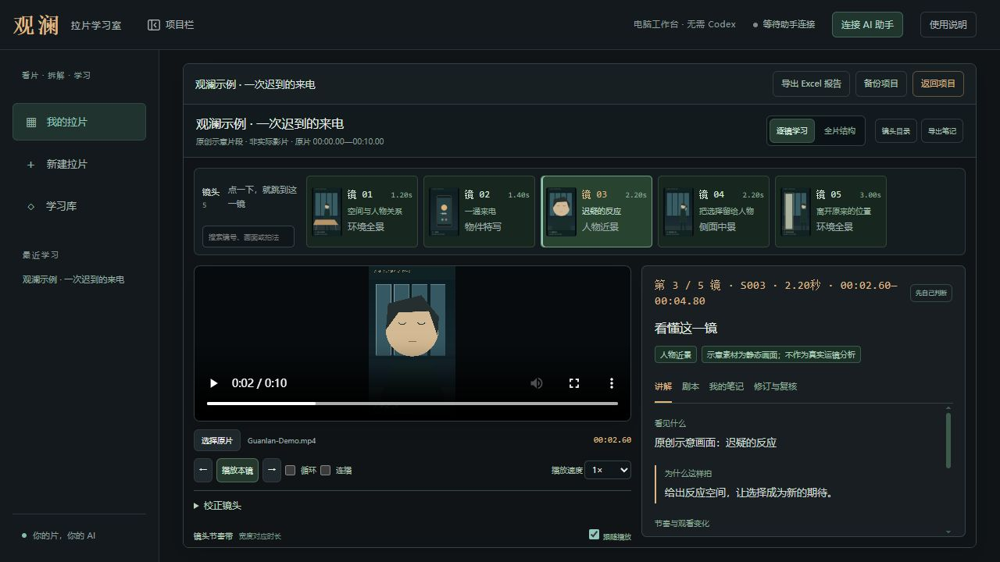
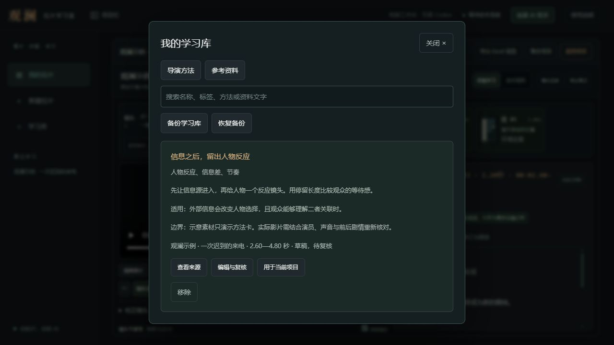

<div align="center">


**把片看懂，把方法带回自己的戏。**

从逐镜观察、剧本对照，到人工复核与导演方法收藏的本地优先学习工具。

[下载 Windows 免安装版](https://github.com/XiaoWuheng/guanlan-film-study/releases/latest) · [打开网页版](https://guanlan-film-study-jz.quirky-wolf-4804.chatgpt.site/) · [快速上手](docs/QUICKSTART.md) · [连接 AI](docs/AI-CONNECTION.md) · [常见问题](docs/FAQ.md)


[](https://github.com/XiaoWuheng/guanlan-film-study/actions/workflows/ci.yml)

</div>

观澜面向希望学习短剧开场钩子、情绪推进、剪辑节奏与镜头语言的创作者。放入一段片，边播放边定位镜头，记录看见与听见的事实，再分析**为什么此刻这样拍、换一种拍法会怎样、自己的戏可以怎样借用**。

有独立剧本时可以对照；没有剧本时，可以识别画面里的烧录字幕作为字幕剧本。学习结束后，导出带截图的 Excel，或把经过核对的方法存进自己的学习库。

> **当前为 v0.3.0 体验版。** 自动拆镜与 AI 解释均需回看核对。默认 AI 流程接收稀疏采样图和文字，不接收原声音轨或完整视频；动态、声音与导演意图不能据此认定。

## 看一眼



*截图使用本项目原创图形示意素材，不包含影视片段、个人项目或密钥。它展示工具操作，不代表真实影片分析效果。*



## 你可以学什么

| 学习内容 | 在观澜里怎样看 |
| --- | --- |
| 镜头时长、景别、运镜与画面 | 原片同步定位，查看起段、中段、末段采样图，逐镜比较 |
| 为什么这样拍 | 将可见证据、拍法解释、替代拍法和适用边界分开阅读 |
| 短剧开场钩子 | 看开场提出了什么问题，观众为何愿意继续看，以及后文怎样回应 |
| 情绪与剪辑节奏 | 将镜头放回段落，观察信息、人物反应、蓄力与释放的接续 |
| 文字怎样成为视听 | 对照独立剧本或字幕原文，关联到具体镜头 |
| 怎样用到自己的戏 | 收藏带来源时间和适用条件的方法；复核后明确选用于某个项目 |

## 开始使用

### Windows：下载后双击启动

1. 到 [Releases](https://github.com/XiaoWuheng/guanlan-film-study/releases/latest) 下载 **`Guanlan-Film-Study-0.3.0-Windows-x64.zip`**。`Source code` 是给开发者的源码包。
2. 解压整个文件夹，双击 **`启动观澜.vbs`**。工作台会在浏览器中打开。
3. 选择视频、学习范围和 AI 使用方式；也可以先手动观察、写笔记。
4. 使用完毕，双击 **`关闭观澜.vbs`**。

免安装包内含 Node.js 与公开链接解析组件，不需要先安装 Codex、Python 或 Node.js。AI 分析需要你自己的助手连接或模型 API。

### 网页：先体验学习界面

打开 [观澜网页版](https://guanlan-film-study-jz.quirky-wolf-4804.chatgpt.site/)。项目保存在当前浏览器；换设备前请备份。模型 API 能否直接连接，取决于服务商是否允许浏览器请求。

| 能力 | 网页版 | Windows 电脑端 |
| --- | --- | --- |
| 本机视频、候选拆镜、同步学习、人工修订 | 支持 | 支持 |
| 自有视觉模型 API | 需服务商允许浏览器连接 | 通过本机转发 |
| AI 助手直接读写项目 | 需电脑端配合 | 支持本机 MCP |
| 公开链接取片 | 交给助手或先取得文件 | 内置直链与部分公开分享页解析 |
| Excel、项目与学习库备份 | 支持 | 支持 |

第一次使用建议从 **1—3 分钟片段**开始。详细步骤见 [快速上手](docs/QUICKSTART.md)。

### 没有影片，也能先试

仓库提供一套 [原创演示素材](examples/README.md)。在“备用交接与项目备份”中恢复 `demo-project.json`，打开学习报告，再选择配套的 `Guanlan-Demo.mp4` 即可体验定位、复核、笔记与导出。

## 一次拉片的流程

```text
放入视频 / 公开链接
       ↓
选择研究范围 → 准备候选镜头 → 回看并局部校正
       ↓
连接自己的助手，或使用自己的视觉模型 API
       ↓
逐镜学习 ↔ 剧本 / 字幕对照 ↔ 人工修订与分项复核
       ↓
导出 Excel / 备份项目 / 收藏导演方法与参考资料
```

**看片与分析同屏。** 镜头目录、节奏带与原片关联，支持跳转、单镜播放、循环、连播和慢放。需要校正时，可按所选帧率估算步进、在当前位置切镜、与下一镜合并；局部调整保留其他镜头，并下载调整前备份。

**人工判断独立保存。** 可以修订景别、运镜、表演、拍法与声音记录，同时保留 AI 原稿。切点、字幕、完整动态、原声、拍法解释分别复核，并可跳到下一待核镜头。相关证据变化后，对应复核状态会失效。

**方法有来源，也有条件。** 方法卡保留来源项目、镜号与时间，记录具体做法、适用条件和边界。未复核的卡片是草稿；只有已复核且主动选入项目的方法，才会进入后续 AI 参考上下文。学习库还能整理文字、图片、PDF 与表格摘要，并关联拉片项目。

## AI 怎么接

- **已有 AI 助手**：Windows 工作台提供标准 stdio MCP。助手需支持本机 MCP 与图片工具返回；连接后直接读素材、提交分析，报告自动更新。
- **自己配置 API**：填写兼容 Chat Completions、支持图片输入的模型地址、模型名与 API Key。
- **暂不连接 AI**：仍可回看片段、校正镜头、写人工观察、整理参考和导出已有内容。

助手订阅不会自动变成 API Key，工具也不会自动借用平台登录凭证。调用可能产生费用，开始前会显示预计请求和图片数量。配置示例与兼容范围见 [AI 连接说明](docs/AI-CONNECTION.md)。

## 导出的是什么

默认导出 **`.xlsx` Excel 文档**，包含嵌入截图、筛选、固定表头及人工记录。

| 工作表 | 内容 |
| --- | --- |
| 逐镜表 | 镜号、时间、镜长、采样图、景别、运镜、画面、节奏、拍法与笔记 |
| 拍法详解 | 表演、机位、光影、声音记录、替代方案及核验状态 |
| 全片分析 | 开场钩子、镜头组合、剪辑方法、借用与练习 |
| 情绪节拍 | 段落时间、信息变化、推测观看效果与关联镜号 |
| 剧本对照 / 剧本原文 | 文字定位、原文、视听实现及对应说明 |
| 使用与范围 | 来源、研究范围、时间约定与核验边界 |
| 人工与 AI 对照 | 保留既有分析与人工修订，方便回查 |

Excel 是静态文档；视频播放与同步高亮在工作台中使用。Excel 内修改的笔记不会自动写回。项目备份和学习库备份用于迁移，两者分别保存。

## 现在的能力范围

- **候选拆镜**：每 0.25 秒采样并寻找画面变化峰值；不是逐帧准确检测，快切、叠化、相似构图和运动仍可能误判。
- **视觉分析**：每镜使用稀疏采样图，不能覆盖完整动作、表演或运镜；“为什么这样拍”是有依据的解释，不是已证实的导演意图。
- **声音**：默认流程未给 AI 提供音轨。字幕可以作为文字证据，不能证明已听过对白、语气、音乐和音效。
- **字幕**：默认取样画面下部；其他位置、极短或模糊字幕可能漏识别。保留原文语言，时间为近似值。
- **片源**：电脑端支持公开 HTTPS 直链与解析组件可取得的单文件视频，最多 512MB；不读取浏览器登录状态，不承诺通用解析网盘、付费或受保护内容。
- **规模**：当前每项目最多 10 分钟、500 镜；学习库单附件最多 4MB，整体约 28MB。
- **验证**：已检查本机核心逻辑、人工记录、切镜与撤销、Excel 导出、公开样片导入及模拟模型流程；尚未完成跨服务商付费模型和大量真实片源的系统测试。

## 数据与隐私

项目默认保存在当前设备。网页版使用浏览器存储；电脑端同时保存在本机 `data/`。电脑端只监听 `127.0.0.1`。

使用 API 时，采样图、字幕、剧本、学习要求及主动选用的方法会发送到你配置的服务商。Key 只在本次页面和请求中使用，不写入项目、学习库、导出报告或源码。参考附件不会自动发给模型。

公开源码和发布包不包含个人影片、项目、笔记、模型凭据或个人历史。更多说明见 [数据与能力说明](docs/DATA-AND-LIMITS.md)。

## 从源码运行

需要 **Node.js 24 或更新版本**。应用无 npm 运行依赖，无需先安装依赖包。

```bash
git clone https://github.com/XiaoWuheng/guanlan-film-study.git
cd guanlan-film-study
npm start
```

在浏览器打开终端显示的本机地址，默认是 `http://127.0.0.1:8780`。源码启动不会自动打开浏览器。Windows 便携包已验证；其他系统可运行基础本机服务，但链接解析组件和桌面启动方式尚未完成适配与实测。

```bash
npm test                 # 核心逻辑测试
npm run check            # 语法、公开文件与文档链接检查
npm run runtime:fetch    # Windows 打包前：下载并校验官方运行组件
npm run build:windows    # Windows 下生成免安装 ZIP 和 SHA256
```

模块与打包说明见 [开发说明](docs/DEVELOPMENT.md)。

## 参与改进

欢迎在 [Issues](https://github.com/XiaoWuheng/guanlan-film-study/issues) 报告问题或提出学习场景，也欢迎提交 PR。复现问题时请使用原创、公开许可或脱敏片段，提供版本、操作步骤、预期与实际结果。

优先改进方向：切点校正体验、音轨与完整动态证据、模型兼容性、字幕校对和跨项目方法检索。路线见 [ROADMAP](ROADMAP.md)，贡献步骤见 [CONTRIBUTING](CONTRIBUTING.md)。

## 相关项目与致谢

- [观澜 AI 导演工作台](https://github.com/XiaoWuheng/guanlan-ai-director)：同作者的分镜与制作工具；本项目专注拉片学习，保持独立使用。
- [yt-dlp](https://github.com/yt-dlp/yt-dlp)：Windows 公开链接解析组件。
- [Node.js](https://nodejs.org/)：电脑端运行时。
- [LosslessCut](https://github.com/mifi/lossless-cut)、[PySceneDetect](https://github.com/Breakthrough/PySceneDetect)：相关视频工具；仓库首页借鉴其清晰的下载入口、上手示例和能力范围组织方式。本项目未接入它们的剪辑或检测引擎。

## 许可

观澜自有代码及原创演示素材采用 [MIT License](LICENSE)。发布包内 Node.js、yt-dlp 及其第三方组件分别保留原许可证，详见 [THIRD_PARTY_NOTICES](THIRD_PARTY_NOTICES.md)。用户导入的影片、剧本、参考资料及模型服务不属于本项目的 MIT 授权范围。

---

**Guanlan Film Study** is a local-first shot-by-shot learning workspace with synchronized playback, script/subtitle references, human review, reusable directing methods and Excel export. Bring your own AI assistant or vision-model API.
